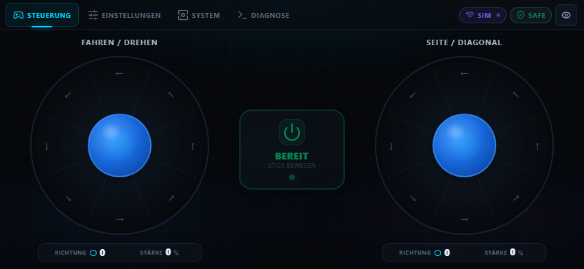
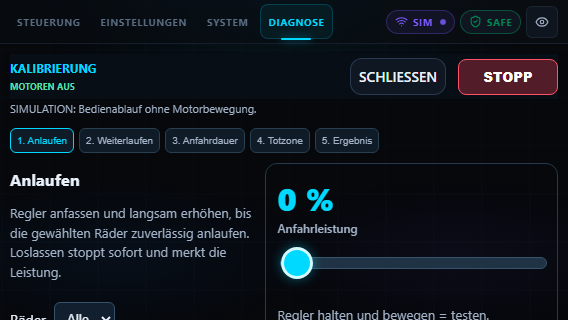

# Mecanum Bot · Web Controller

**Zwei Daumen, vier Räder — die Bedienoberfläche für den ESP32-Mecanum-Bot.**

Eine React-Oberfläche zum Fahren, Einstellen und Kalibrieren direkt im Browser. Auf dem ESP32 wird sie aus LittleFS ausgeliefert; lokal lässt sich der komplette Bedienablauf in einer deutlich gekennzeichneten Simulation ausprobieren.


[](https://github.com/KajoGreenpost/mecanum-bot)

[**Firmware & Downloads**](https://github.com/KajoGreenpost/mecanum-bot/releases/latest) · [ESP32-Repository](https://github.com/KajoGreenpost/mecanum-bot) · [API-Dokumentation](https://github.com/KajoGreenpost/mecanum-bot/blob/main/docs/api.md)



## Die Oberfläche

| Tab | Was du dort machst |
| --- | --- |
| **Steuerung** | Mit zwei Sticks fahren, drehen und seitwärts bewegen; jederzeit stoppen |
| **Einstellungen** | Geschwindigkeitsstufe, Motorabstimmung, Invertierungen und Ruhezeit speichern |
| **System** | Systeminformationen anzeigen und die ESP32-Wartungsseite öffnen |
| **Diagnose** | Debug-Ausgabe verfolgen oder den Kalibrierungs-Assistenten starten |

### Für die Bedienung am Handy

- **Querformat als Fahransicht:** große Sticks und eine kompakte Werkzeugleiste.
- **Kein Scrollen auf der Steuerungsseite:** beide Daumen bedienen ihre Sticks unabhängig; Touch-Gesten verschieben die Seite nicht.
- **Automatischer Start:** neue Stickbewegung aktiviert das Fahrzeug. Loslassen stoppt die Bewegung sofort.
- **Ruhezeit statt ständigem Abschalten:** standardmäßig zehn Sekunden, in den Einstellungen von 0 bis 30 Sekunden veränderbar.
- **Sofortiger Stopptaster:** nach einem Sicherheitsstopp müssen gehaltene Gesten erst gelöst werden.

Der linke Stick steuert vorwärts/rückwärts und drehen. Der rechte steuert seitwärts und diagonal; seine reinen oberen/unteren Sektoren sind unbenutzt. Beide Sticks verwenden acht Richtungssektoren mit Stärke von 0 bis 100 %.

### Kalibrierung durch direktes Regeln



Unter **Diagnose → Kalibrierung** regelt die Person am Bot die Leistung direkt, statt eine automatische Testfolge ständig bestätigen zu müssen:

1. **Anlaufen:** Leistung erhöhen, bis die gewählten Räder zuverlässig starten. Loslassen stoppt und merkt den Boost.
2. **Weiterlaufen:** nach dem Anfahrimpuls die Leistung herunterregeln und Start-Minimum bestimmen.
3. **Anfahrdauer:** kurze Tests mit einer selbst gewählten Boost-Dauer von 0–300 ms auslösen.
4. **Totzone:** entspannte und bewusst kleine Daumenbewegungen messen, während die Motoren ausgeschaltet bleiben.
5. **Ergebnis:** neue Werte gemeinsam speichern; andere Einstellungen bleiben erhalten.

Einzelne Räder und beide Drehrichtungen sind auswählbar. Der Stopptaster und Teststatus bleiben sichtbar. Ohne Drehzahlsensoren beurteilt die Person am Fahrzeug das Anlaufen und Weiterdrehen selbst. Die Simulation prüft den Bedienablauf und erzeugt keine echten Motor-Messwerte.

## Lokal starten

Voraussetzungen: **Git, Node.js und npm**.

```sh
git clone https://github.com/KajoGreenpost/mecanum-bot-website.git
cd mecanum-bot-website
npm ci
npm run dev
```

Die lokale Oberfläche ist standardmäßig unter **[http://localhost:5173](http://localhost:5173)** erreichbar. Sie läuft dort in der **Simulation**. Einstellungen werden lokal im Browser gespeichert; simulierte Diagnosemeldungen sind entsprechend markiert.

Das ist eine Entwicklungsansicht. Ein lokal gestarteter Server verbindet sich nicht automatisch mit einem Fahrzeug.

## Simulation und echter ESP32

| Aufruf | Betriebsart |
| --- | --- |
| `http://localhost:5173` oder `127.0.0.1` | Simulation, keine Fahrzeugsteuerung |
| `http://192.168.4.1/` | Echte ESP32-API über relative HTTP-Pfade |
| Andere Hostnamen | Simulation |

Die Entscheidung steht in [`src/api/env.js`](src/api/env.js). Wenn ein ESP32 eine andere Adresse verwendet, muss sie dort in `ESP_HOSTS` eingetragen und die Website neu gebaut werden. Im ESP32-Modus führt ein API-Fehler zu einer sichtbaren Fehlermeldung; die Anwendung wechselt dabei nicht heimlich zur Simulation.

Die [Firmware](https://github.com/KajoGreenpost/mecanum-bot) betreibt das WLAN und die HTTP-API. Es gibt keine Cloud-Abhängigkeit und keinen separaten Backend-Server für die Fahrsteuerung.

## Auf dem Bot installieren

### Fertige Images verwenden

Im [aktuellen Firmware-Release](https://github.com/KajoGreenpost/mecanum-bot/releases/latest) liegen **`firmware.bin` und `littlefs.bin`**. Die aktuelle Kombination ist **Firmware 1.0.4 + Website 1.3.0**.

Mit dem Bot-WLAN verbinden und **[http://192.168.4.1/maintenance](http://192.168.4.1/maintenance)** öffnen. Zuerst Firmware, anschließend Website über die getrennten Update-Felder installieren. Danach die Steuerungsseite neu laden. Für die Kalibrierung müssen beide Versionen zusammenpassen.

Die erste USB-Installation, Motorpins, Zugangsdaten und Partitionierung sind im [Firmware-README](https://github.com/KajoGreenpost/mecanum-bot#hardware-und-erste-usb-installation) beschrieben.

### Eigene Website bauen

Für ein normales Vite-Build:

```sh
npm run build
npm run preview
```

Die statischen Dateien entstehen in `dist/`. Vite verwendet relative Asset-Pfade (`base: './'`), damit die gebaute Oberfläche direkt vom ESP32 ausgeliefert werden kann.

Für ein fertiges LittleFS-Image die Repos nebeneinander klonen:

```text
workspace/
├── mecanum-bot/
└── mecanum-bot-website/
```

Unter Windows im **Firmware-Repo** ausführen:

```powershell
powershell -NoProfile -ExecutionPolicy Bypass -File .\tools\build-web.ps1
```

Der Helfer prüft und baut die Website, kopiert `dist/` nach `mecanum-bot/data/`, schreibt die Version aus `package.json` und erzeugt **`mecanum-bot/littlefs.bin`**. Diese Datei wird unter **Webinterface Update** hochgeladen. Ein Website-Update verändert die Firmware nicht.

## Tests

```sh
npm test
```

Funktionsprüfungen für Einstellungen, Verbindung, Steuer-Heartbeat, Diagnose, Kalibrierung und Totzone.

```sh
npx playwright install chromium
npm run test:layout
```

Die Browser-Tests prüfen unterschiedliche Handy-Querformate, zwei gleichzeitige Berührungen, Scroll-Verhalten, Hochformat-Stopp, gespeicherte Einstellungen sowie die Kalibrierung. Screenshots entstehen unter `test-results/`.

**Aktueller Prüfstand:** 12 Funktionstests und 15 Browser-Tests erfolgreich; Produktionsbuild und LittleFS-Image erstellt. Die README-Screenshots zeigen die Simulation. Ein Test der neuen Kalibrierung am realen Fahrzeug steht noch aus.

## Verbindung und Stoppen

Bei Freigabe wird alle **50 ms** ein vollständiger Steuerrahmen gesendet; im deaktivierten Zustand einmal pro Sekunde. Es wird höchstens eine normale Steueranfrage gleichzeitig übertragen. Die Firmware stoppt bei fehlenden gültigen Steuerpaketen nach **300 ms**, unabhängig von der einstellbaren Ruhezeit nach dem Loslassen.

Beim Wechsel aus der Steuerung, einer verborgenen Seite, einem Verbindungsverlust oder Hochformat auf dem Handy wird sofort deaktiviert. Eine gehaltene Geste darf nach einem Sicherheitsstopp nicht unbemerkt erneut anfahren.

Während der Kalibrierungs-Assistent geöffnet ist, pausieren normale Fahr-Heartbeats. Motortests verwenden eine eigene Sitzung, einen 300-ms-Watchdog und eine Begrenzung auf 15 Sekunden für kontinuierliche Tests. Debug-Polling pausiert während der Kalibrierung.

## Aufbau

```text
mecanum-bot-website/
├── src/
│   ├── api/             # Gemeinsame API, ESP32-Adapter und Simulation
│   ├── components/      # Sticks, Tabs, Einstellungen, Diagnose, Kalibrierung
│   ├── hooks/           # Steuerung, Pointer-Gesten und Kalibrierungssitzungen
│   └── styles/          # Layout und Darstellung
├── public/              # Statische Dateien
├── docs/images/         # README-Vorschau
├── tests/               # Funktions- und Browser-Tests
└── dist/                # Gebaute Website
```

Komponenten greifen über [`vehicleApi`](src/api/vehicleApi.js) auf das Fahrzeug zu. [`realEspApi`](src/api/realEspApi.js) verwendet relative ESP32-Endpunkte, [`simulationApi`](src/api/simulationApi.js) bildet den Bedienablauf lokal nach. [`useControlState`](src/hooks/useControlState.js) hält die Fahrsteuerung von den React-Darstellungsupdates getrennt.

Für Fehlerberichte bitte Web-/Firmware-Version, Browser, Bildschirmgröße und reproduzierbare Schritte angeben. UI-Probleme gehören in die [Issues dieses Repos](https://github.com/KajoGreenpost/mecanum-bot-website/issues), Motor- oder Firmware-Probleme in das [Firmware-Repo](https://github.com/KajoGreenpost/mecanum-bot/issues).
